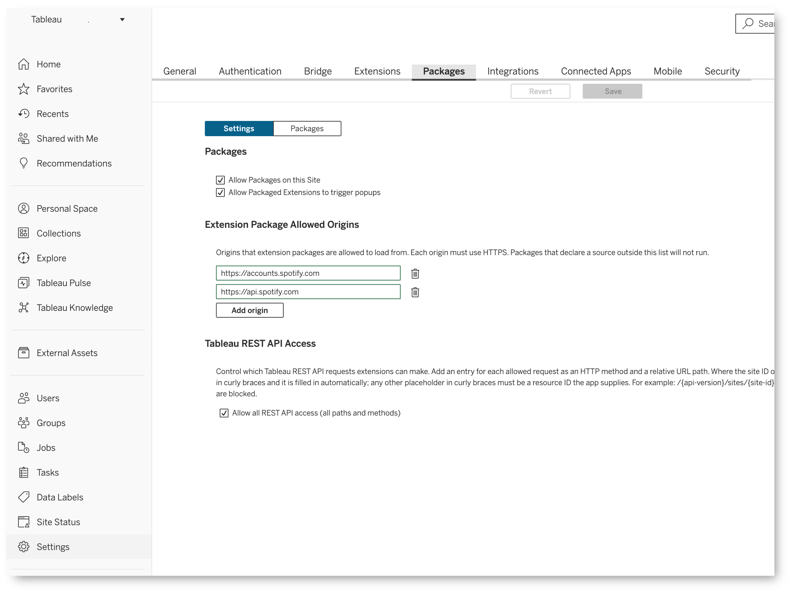
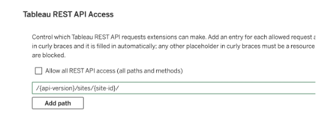
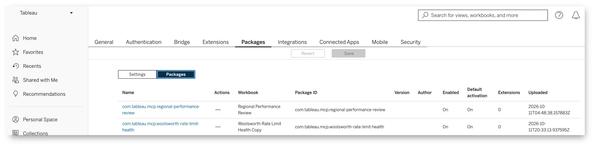
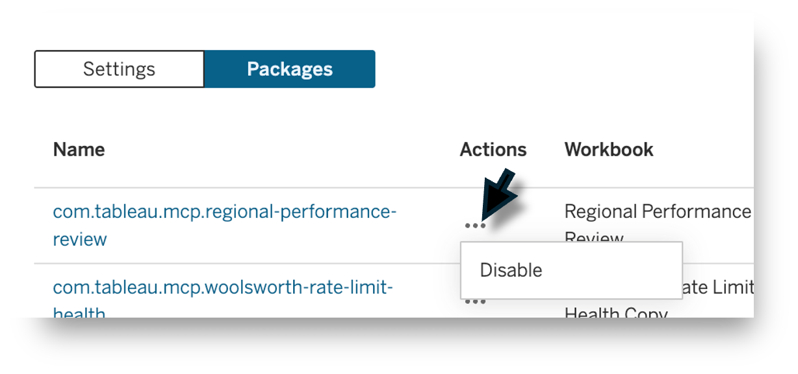

The data apps beta is available only on Tableau Cloud.

As a site administrator, you manage data apps through the **Packages** tab on the site's **Settings** page. Data app enablement is configured **per site**. Review and configure these controls for each site where you want users to run data apps.

Data apps include application resources in packages. The Packages tab lets you control the capabilities allowed for packages across the site and disable individual packages when needed.

## Open the Packages tab

1. Sign in to Tableau Cloud as a site administrator and select the site you want to manage.
2. In the navigation pane, select **Settings**.
3. On the site Settings page, select the **Packages** tab.

Within this tab, use the **Settings / Packages** toggle to switch between two views:

- **Settings** controls site-wide package enablement and allowed capabilities.
- **Packages** lists all packages on the site and provides actions for individual packages.

## Configure site-wide package settings

Select **Settings** in the toggle to review the site's package configuration.

### Enable packages on the site

Use **Allow Packages on this Site** to control whether packages can run on the selected site. Enable this option when you want to allow data apps on the site.

This is the site-wide control. To disable a specific package while allowing others to run, use the package's Actions menu in the [Packages view](#disable-an-individual-package).

### Allow popups

Use **Allow Packaged Extensions to trigger popups** to control whether extensions within packages can open popup windows. Review whether your data apps need this capability before allowing it.

### Control external origins

Under **Extension Package Allowed Origins**, specify the origins from which packages can load resources. Each origin must use HTTPS. Packages that declare a source outside this list will not run.

Use **Add origin** to add an approved origin and the delete control beside an entry to remove it. Review the purpose of each external service and what data the app sends to it. See [data app security](./trex_dataapp_security.md#external-origins).

### Control Tableau REST API access

The `fetch()` method added to the Extensions API for this release enables data apps to make a curated set of Tableau REST API requests. Under **Tableau REST API Access**, control which of these requests elements of a package can make. Review the operations required by the data apps on your site before approving access.

The **Allow all REST API access (all paths and methods)** option permits access across API paths and methods.

When this option is unchecked, you must explicitly add the REST API requests available to extension code running in packages on the site. Requests outside the allowed list are blocked.

1. Clear **Allow all REST API access (all paths and methods)**.
2. Select **Add path** to add an entry for an allowed request.
3. Specify the request's HTTP method and relative REST API URL path. Add an entry for each request your apps need.
4. Select **Save** to apply the site's configuration.

Use the `{api-version}` and `{site-id}` placeholders where appropriate in the path; the site ID is filled in automatically. Other resource ID placeholders must be supplied by the app. Approve only the operations required by your apps.

These settings do not grant users additional Tableau content or data permissions. See [data app security](./trex_dataapp_security.md#tableau-rest-api-access) for guidance on reviewing API access.

When you finish changing the site's settings, select **Save**.

## View the packages on your site

Select **Packages** in the toggle to display a table of all packages on the selected site.

The table contains the following columns:

| Column | Information |
| --- | --- |
| Name | The package name. |
| Actions | A three-dot menu for actions on the individual package. |
| Workbook | The workbook associated with the package. |
| Package ID | The package identifier. |
| Version | The package version. |
| Author | The package author. |
| Enabled | Whether the package is enabled. |
| Default activation | The package's default activation setting. |
| Extensions | The number of extensions listed for the package. |
| Uploaded | When the package was uploaded. |

Use the workbook and package metadata to identify the application you want to review. Check its enablement status before investigating why a data app is unavailable to users.

## Disable an individual package

To prevent a specific package from running on the site:

1. In the **Packages** view, locate the package in the table.
2. Select the three-dot menu in its **Actions** column.
3. Select **Disable**.
4. Check the package's **Enabled** status to verify the change.

Coordinate with the workbook owner when disabling a package so they can address the impact on users. Review the package again when its code, external dependencies, or requested API access changes.

## Related guidance

- [Data app security](./trex_dataapp_security.md)
- [Get Started with data apps](./trex_dataapp_getstarted.md)
- [Tableau data app Manifests](./delet-this-trex_dataapp_manifest.md)
