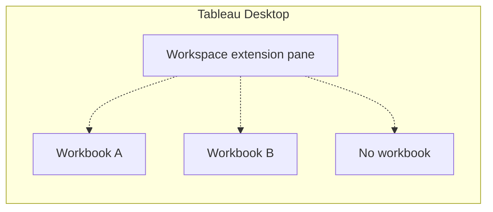

A workspace extension is a web app that lives at the Tableau *application* level, not inside a workbook. Dashboard extensions sit in a dashboard. Viz extensions sit in a worksheet. A workspace extension is neither of those — it's a tool that stays around while you open, close, and switch workbooks.

That's the whole idea: these are tools you install, not content you save with a workbook.

---

## Components of a Tableau workspace extension

Same three pieces as every other Tableau extension: a manifest file (`.trex`), a web page (`.html`) that loads the Tableau Extensions API library, and the JavaScript that does the work.

## What it looks like in Tableau

A workspace extension is not a dashboard zone or a Marks card viz. The manifest declares where it shows up. On Desktop today:

1. You put the `.trex` in **My Tableau Repository/Extensions/**.
2. `<authoring-toolbar>` adds a button to the authoring toolbar. `<authoring-menu>` adds an item to the authoring menu.
3. Choosing either one opens the extension in a **side pane**.

The manifest for that button and menu item is [hello-world-extension.trex](./trex_workspace_manifest.md#sample-manifest-file).

## What you can do with one

Anything that needs to hang around for a whole Tableau session:

* Utilities that don't belong in a single dashboard or worksheet.
* Tools that watch workbook and sheet changes and update themselves.
* Things that still make sense when no workbook is open at all.

When a workbook *is* open, the extension can read it (`name`, `sheets`, `activeSheet`). When it isn't, the extension keeps running — `workspaceContent.workbook` is empty.

## How it differs from dashboard and viz extensions

All three types are web apps on the same Extensions API. The difference is *where they live* and *what they're for*.

| | Dashboard / viz | Workspace |
|---|---|---|
| **Scope** | One workbook | The Tableau app |
| **Saved with** | The `.twb` / `.twbx` | A `.trex` in My Tableau Repository (not the workbook) |
| **UI** | Embedded in a dashboard or worksheet | Authoring toolbar button or authoring menu item, opening a side pane |
| **Workbook** | Always has one | Can have none |
| **Lifespan** | Comes and goes with the workbook | Stays while the `.trex` is in My Tableau Repository |

A few more distinctions:

* Dashboard and viz extensions are *content*. They travel with the workbook. Workspace extensions are *tools*. They live as a `.trex` under **My Tableau Repository/Extensions/**, not inside the workbook.
* The manifest's `<entry-points>` are what show the side pane. See [the manifest](./trex_workspace_manifest.md).
* Listen for `WorkbookChanged` and `ActiveSheetChanged` on `tableau.extensions.workspaceContent`.

The extension is independent of whichever workbook is open — including none.

## Where it is supported

This authoring path is **Tableau Desktop**, starting in %coming_release%. Server still uses the legacy `<target>toolbar</target>` manifest, which this guide does not cover.
